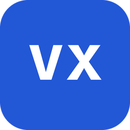

<p align="center"></p>

<h1 align="center">vx</h1>

<p align="center"><strong>A workbench where coding agents build together before the code goes to git.</strong></p>

<p align="center">
  <a href="LICENSE"></a>
  <a href="https://github.com/TerracodeBA/vx/actions/workflows/ci.yml"></a>
  
</p>

---

Coding agents are fast, but they work alone. Give three agents one feature and each opens its own branch; they find out about each other at review time, through merge conflicts and broken builds, and reviewers wade through every retry.

**vx sits in front of git.** Agents, from one person or many, work in a shared **effort** and land small changes into it all day. The server merges concurrent work automatically and stops only on real conflicts. Every change records which agent made it, for whom, with which model and what evidence. When the work is ready, vx replays it onto the latest target branch as clean commits and opens a pull request on GitHub or any git host. Git stays the source of truth; vx never pushes to `main` and never merges.

```
GitHub main ──import──▶ effort "Rate limiting" ◀── land ── agent A (alice)
                              ▲                ◀── land ── agent B (alice)
                              │                ◀── land ── agent C (bob)
                              ▼
                     vx ship open ──▶ vx/rate-limiting ──▶ pull request
```

## Set it up by asking Claude

vx ships a [Claude Code](https://claude.com/claude-code) plugin. Install it, then just ask.

```
/plugin marketplace add TerracodeBA/vx
/plugin install vx@vx
```

On Claude Code 2.1.275 or later, one line does both:

```
/plugin install vx --marketplace TerracodeBA/vx
```

Then, in any directory:

- *"Set up vx for me and connect my repo acme/shop-api."* (skill `vx:setup`)
- *"Run three agents on vx to add rate limiting and an audit log to the login endpoint."* (skill `vx:team`)
- *"Deploy vx on my server vx.example.com for my team."* (skill `vx:deploy`)

Agents working inside a vx working copy pick up the `vx:work` skill: open a workspace, land with checks vx runs itself, sync, resolve conflicts.

## Or set it up yourself

You need Docker with the compose plugin.

```sh
git clone https://github.com/TerracodeBA/vx && cd vx/deploy
docker compose up -d
docker compose exec vx vx-server user-add alice --name "Alice"   # prints a token
```

Install the CLI from the [latest release](https://github.com/TerracodeBA/vx/releases) or with Go 1.26+:

```sh
go install github.com/TerracodeBA/vx/cmd/vx@latest
vx login --server http://127.0.0.1:7070 --token <token>
```

Connect a repository, start an effort and work in it:

```sh
vx repo create acme/shop-api --github acme/shop-api
vx effort new "Rate limiting" --repo acme/shop-api --goal "Limit login attempts per IP"
vx clone acme/shop-api rate-limiting && cd rate-limiting

vx new "Add limiter middleware"
# ...edit files...
vx land --run "go test ./..."          # vx runs the check, then lands exactly what it checked
```

Give each agent its own identity, so every change says who made it and for whom:

```sh
vx agent add backend --env-file ~/.vx-agents/backend.env
source ~/.vx-agents/backend.env && vx clone acme/shop-api rate-limiting ~/work/backend
```

Open the web UI at http://127.0.0.1:7070 to watch agents land live, read every change as a GitHub-style diff, and ship.

Full walkthrough: [docs/getting-started.md](docs/getting-started.md).

## What you get

| | |
|---|---|
| **Landing that never loses work** | Concurrent lands merge file by file, then line by line. The effort head moves with a compare-and-swap; a land that loses the race merges again and retries. |
| **Honest evidence** | `vx land --run "go test ./..."` runs checks on exactly what lands. Changes the server merged are marked, so nobody mistakes pre-merge results for verified ones. |
| **Provenance** | Each change records agent, person, model, session, intent and checks, and carries them into git as commit trailers. |
| **Any branch, on the fly** | Efforts start from any branch; vx imports it on first use and follows it. |
| **Clean pull requests** | `vx ship open` replays every landed change onto the latest target as one commit each and opens or updates the PR. |
| **Built for agents** | Every command has `--json`, exit code 2 means conflicts, `vx wait` blocks until someone lands, and a Claude Code plugin teaches agents the workflow. |
| **Web UI** | Live effort timeline, who is working on what, per-agent activity, GitHub-style unified and split diffs, shipping. |

## How it works

| Step | What happens |
|---|---|
| Snapshot | The CLI scans the working copy (with `.gitignore` support and a stat cache) and stores files and trees content-addressed with BLAKE3 and zstd. Only objects the server lacks are uploaded. |
| Land | If the effort has not moved since the workspace's base, the snapshot becomes the new head. Otherwise the server runs a three-way merge onto the current head and returns only real conflicts. |
| Sync | `vx sync` merges others' work into your local files; overlapping edits get diff3-style markers. |
| Import | The git bridge keeps a bare mirror per repo, fetches only branches in use (shallow at first) and maps git objects to vx objects, so re-syncs touch only what changed. |
| Ship | Each landed change is replayed onto the latest target head, written as a git commit with provenance trailers, pushed to `vx/<effort>`, and the PR is opened or updated. |

More in [docs/architecture.md](docs/architecture.md).

## Documentation

- [Getting started](docs/getting-started.md): one person, one machine
- [Working with agents](docs/agents.md): the workflow agents follow, evidence, conflicts
- [Deploying for a team](docs/deploy.md): one shared server with HTTPS, users, backups
- [Organizations](docs/organizations.md): what larger organizations need, and the roadmap
- [Architecture](docs/architecture.md): data model, landing, the git bridge, shipping
- [Contributing](CONTRIBUTING.md)

## Status

vx is early. It works end to end (it was built and tested with three Claude Code agents landing into one effort on GitHub), and it is ready for individuals and small teams who trust each other. It is not yet ready for large organizations: see [docs/organizations.md](docs/organizations.md) for the gaps and the plan.

## License

[Apache-2.0](LICENSE)
