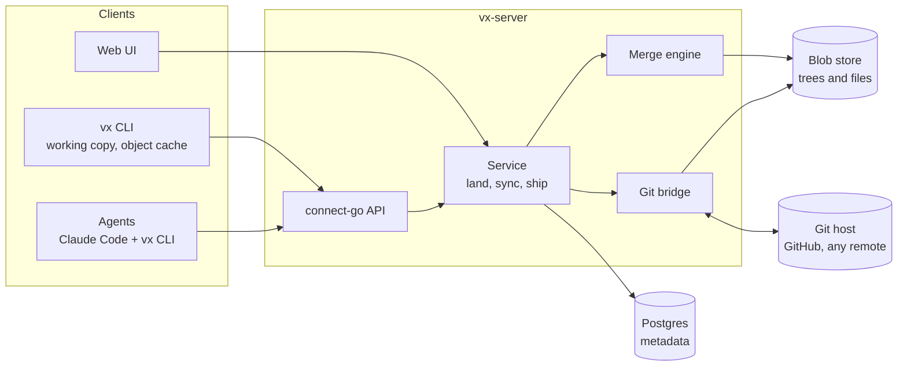

# Architecture

vx is a server-centric version control layer in front of git. The server does the heavy work (merging, rebasing, history queries, writing git commits); clients keep a working copy and a local object cache.



## Data model

| Object | What it is | Where |
|---|---|---|
| Blob | File contents, addressed by BLAKE3 (domain-separated by kind), zstd-compressed | Blob store |
| Tree | One directory: sorted entries (name, mode, hash) | Blob store |
| Changeset | One change: parents, tree, intent, author (agent, person, model, session), evidence, stable change ID; hashed over a canonical encoding | Postgres |
| Effort | A shared line of work: base branch, base and head changesets, version for compare-and-swap | Postgres |
| Workspace | One task inside an effort: intent, change ID, base | Postgres |
| Branch | An upstream branch vx follows, with its imported head | Postgres |
| Shipment | A pushed `vx/` branch and its pull request | Postgres |

Changesets list their tree, so two snapshots are compared by walking both trees and skipping every subtree whose hash is equal. The cost of a diff, a merge or an upload is proportional to the size of the change, not of the repository.

## Landing

```mermaid
sequenceDiagram
  participant A as Agent (vx CLI)
  participant S as vx-server
  participant DB as Postgres
  A->>A: snapshot working copy into trees
  A->>S: upload objects the server lacks
  A->>S: Land(workspace, base, tree, evidence)
  S->>DB: read effort head
  alt head == base
    S->>S: new tree = snapshot
  else effort moved
    S->>S: three-way merge(base, snapshot, head)
    S-->>A: conflicts, if any (nothing lands)
  end
  S->>DB: insert changeset; UPDATE efforts SET head WHERE version = seen
  alt another land won the race
    S->>S: merge again onto the new head and retry
  end
  S-->>A: landed changeset; CLI updates the working copy
```

The merge runs file by file (`internal/engine`), then line by line for files both sides changed (`internal/merge`, Myers diff plus diff3). Moving the head is a single-row compare-and-swap, so concurrent lands never lose work.

After a land, the server parses the Go packages the change touched (`internal/engine/gocheck.go`) and returns warnings for top-level names declared twice in one package and for changed Go files that do not parse: the case where two changes each add the same function in different files, the text merges cleanly and the package stops compiling. Warnings never block a land and are not stored yet; ship plans report them too.

`vx land --run` adds a client-side loop: sync if the effort moved, run the checks on the merged files, land with `require_up_to_date`, and repeat if someone landed in between. The evidence then describes exactly the tree that landed. When the server merges instead, the changeset records the author's `snapshot_tree`, and every view marks its evidence as gathered before the merge.

## Git bridge

- One bare git mirror per repository under the data directory (go-git, no git binary needed).
- Only branches in use are fetched; the first import is shallow.
- Git objects are mapped to vx objects in Postgres (`git_objects`), so later imports skip unchanged subtrees and exports reuse git objects.
- Without a GitHub token the bridge uses SSH with the server user's agent and `known_hosts`; with a token it uses HTTPS and the REST API.

## Shipping

1. Sync the target branch.
2. Replay each landed vx changeset, oldest first, onto the target head: take its tree when its parent equals the current tree, otherwise three-way merge it onto the current tree. Stop at the first conflict and report it.
3. Write one git commit per change: the intent as the message, provenance trailers (`Vx-Change-Id`, `Vx-Agent`, `Vx-On-Behalf-Of`, `Vx-Model`, `Vx-Evidence`), the person as author.
4. Push to `vx/<effort>` (the bridge refuses any other branch) and open or update the pull request.

## Code layout

| Package | Responsibility |
|---|---|
| `internal/hash` | BLAKE3 object hashes |
| `internal/blob` | Content-addressed store (disk, memory) with verification on read |
| `internal/object` | Trees, manifests, changesets, tree diff and in-place edits |
| `internal/merge` | Line diff, unified diff output, three-way text merge |
| `internal/engine` | Tree-level three-way merge |
| `internal/store` | Postgres access and migrations |
| `internal/service` | Application logic: repos, efforts, workspaces, land, ship |
| `internal/gitbridge` | Import from and export to git hosts |
| `internal/api` | connect-go handlers |
| `internal/web` | Web UI |
| `internal/client` | Go client with batched object transfer |
| `internal/workcopy` | Working copy: scan, stat index, apply |
| `internal/cli` | The `vx` command line |
| `proto/` | API definition |
