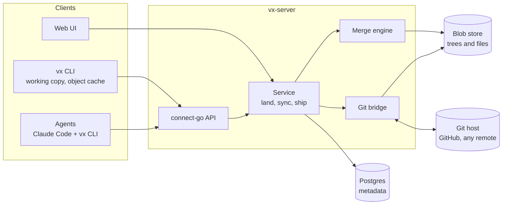

# Architecture

vx is a server-centric version control layer in front of git. The server does the heavy work (merging, rebasing, history queries, writing git commits); clients keep a working copy and a local object cache.



## Data model

| Object | What it is | Where |
|---|---|---|
| Blob | File contents, addressed by BLAKE3 (domain-separated by kind), zstd-compressed | Blob store |
| Tree | One directory: sorted entries (name, mode, hash) | Blob store |
| Changeset | One change: parents, tree, intent, author (agent, person, model, session), evidence, stable change ID; hashed over a canonical encoding | Postgres |
| Effort | A shared line of work: base branch, base and head changesets, version for compare-and-swap | Postgres |
| Rebase | One replay of an effort onto a newer branch head: state, progress, conflicts | Postgres |
| Workspace | One task inside an effort: intent, change ID, base | Postgres |
| Branch | An upstream branch vx follows, with its imported head | Postgres |
| Shipment | A pushed `vx/` branch and its pull request | Postgres |

Changesets list their tree, so two snapshots are compared by walking both trees and skipping every subtree whose hash is equal. The cost of a diff, a merge or an upload is proportional to the size of the change, not of the repository.

## Objects are scoped per repository

Blobs and trees are stored once, deduplicated across the whole server. Which repository an object belongs to is recorded separately in Postgres (`repo_objects`: repository, hash). Every object request names its repository, and:

- `GetObjects` needs read access to the repository and serves only objects that are part of it. Any other hash is reported as not found, with the same message as a hash nobody ever stored, so the store cannot be probed across repositories.
- `MissingObjects` answers for the repository: an object stored only for another repository counts as missing, so the client uploads it.
- `PutObjects` needs write access. The server hashes the bytes it receives and records those hashes for the repository, so an object becomes part of a repository only when its content was sent. Uploading content the store already has is cheap: the bytes are not written again.
- A land checks that every tree and blob its snapshot adds over its base is part of the repository, checking each level of trees before reading it. A snapshot that names another repository's objects without uploading them is refused, and learns nothing about them.

Objects also become part of a repository when the git bridge imports them and when the server makes them itself from the repository's objects (three-way merges on land and ship). The empty tree is part of every repository. The web UI and the MCP tools read file contents through `Service.BlobReader`, which checks the same things.

Requests without a repository come from clients older than v0.2 and are refused with "this vx is too old for the server: update vx".

Repositories from before `repo_objects` are indexed once, from their changesets (`internal/service/objects_backfill.go`). Migration 009 queues every existing repository, and each server start also queues any repository that has changesets but no recorded objects. The server then walks the queued repositories one at a time in the background, recording for each changeset what differs from its parent's tree, and logs its progress. An object request for a repository that is still queued backfills that repository first, so it waits for its own walk only. The walk is idempotent and resumable; `vx-server backfill-objects [--repo OWNER/NAME]` runs it by hand.

## Landing

```mermaid
sequenceDiagram
  participant A as Agent (vx CLI)
  participant S as vx-server
  participant DB as Postgres
  A->>A: snapshot working copy into trees
  A->>S: upload objects the repository lacks on the server
  A->>S: Land(workspace, base, tree, evidence)
  S->>DB: read effort head
  alt head == base
    S->>S: new tree = snapshot
  else effort moved
    S->>S: three-way merge(base, snapshot, head)
    S-->>A: conflicts, if any (nothing lands)
  end
  S->>DB: insert changeset; UPDATE efforts SET head WHERE version = seen
  alt another land won the race
    S->>S: merge again onto the new head and retry
  end
  S-->>A: landed changeset; CLI updates the working copy
```

The merge runs file by file (`internal/engine`), then line by line for files both sides changed (`internal/merge`, Myers diff plus diff3). Moving the head is a single-row compare-and-swap, so concurrent lands never lose work.

Line merge rules, per region between lines both sides kept from base:

- Changed on one side only: take that side.
- Changed the same way on both sides: take it once.
- Both sides only inserted lines (the base region is empty) and the insertions differ: keep both, the side that landed first (the effort head, or the ship target) before the incoming one. The diff of base to each side decides where an insertion sits, so a line both sides kept from base (a closing brace after a list) stays once and both insertions go before it, while lines each insertion brings itself (its own closing brace or trailing blank line) are kept once per side. If the earlier side's insertion ends the file without a newline, one is added so the lines do not run together. Engine results list these paths in `KeptBoth` (a subset of `AutoMerged`); `Service.Land` returns them as `LandResult.KeptBoth` and `vx sync` reports them as well.
- Anything else, where either side changed or deleted base lines in the region, is a conflict written with diff3 markers. Keep-both never applies when the base file is empty or missing (both sides created the file), to binary files, or when either side already contains conflict markers. There is no per-repo switch yet.

After a land, the server parses the Go packages the change touched (`internal/engine/gocheck.go`) and returns warnings for top-level names declared twice in one package and for changed Go files that do not parse: the case where two changes each add the same function in different files, the text merges cleanly and the package stops compiling. Warnings never block a land and are not stored yet; ship plans report them too.

`vx land --run` adds a client-side loop: sync if the effort moved, run the checks on the merged files, land with `require_up_to_date`, and repeat if someone landed in between. The evidence then describes exactly the tree that landed. When the server merges instead, the changeset records the author's `snapshot_tree`, and every view marks its evidence as gathered before the merge.

## Rebasing an effort

`vx effort rebase` (`EffortService.RebaseEffort`) moves an effort onto the latest head of its base branch, after syncing that branch from upstream:

1. Record a running rebase (`effort_rebases`; a partial unique index allows one running or stopped rebase per effort) with the target changeset, the effort's old base and head, and the list of changes to replay: the vx changes from the old base to the head, oldest first.
2. For each change C with parent P: if P's tree equals the rebased chain so far, take C's tree; otherwise three-way merge base P, ours C, theirs the chain so far, exactly as shipping does, so keep-both puts the branch's lines first. Store the result as a new changeset with the same change id, intent, author, evidence and creation time, the chain so far as its parent, and `rebase` provenance: target (`onto`, `onto_git_sha`, `branch`), the changeset it replays (`from`), who ran it and, after a conflict, who resolved it. The provenance is part of the hashed encoding. Replayed changesets are stored without an effort until the rebase finishes.
3. On a conflict, save the progress and stop (`stopped`). `ContinueRebase` takes the resolved tree of that change (uploaded like a land's snapshot, on top of the chain so far), stores it as the change's rebased version marked `resolved_by`, and goes on; it may stop again. `AbortRebase` marks the rebase aborted; the effort never moved.
4. When every change replayed, compare the effort head with the newest old-chain head the rebase knows. Changes landed since (lands never wait for a rebase) are replayed the same way, and the check repeats until the head is stable.
5. In one transaction: compare-and-swap the rebase row (on its version, so a concurrent continue or abort wins cleanly) and the effort (base branch, base and head, on the effort version, so a land that sneaks in sends the rebase back to step 4), and attach the replayed changesets to the effort.

Every step that changes the rebase row is a compare-and-swap on its version. A change id resolves to its newest version on the effort; a version stored by a stopped or aborted rebase never wins. Workspaces opened before a rebase keep their old base: `Land` and `SetBase` accept a base on the old chain of a finished rebase, and the three-way merge from that base onto the rebased head brings their edits across. Evidence on rebased changes is labelled as gathered before the rebase wherever it is shown, like the evidence of changes the server merged.

## Git bridge

- One bare git mirror per repository under the data directory (go-git, no git binary needed).
- Only branches in use are fetched; the first import is shallow.
- Git objects are mapped to vx objects in Postgres (`git_objects`), so later imports skip unchanged subtrees and exports reuse git objects.
- Repositories of a GitHub App installation use its installation token (HTTPS as `x-access-token`, cached until shortly before it expires). Others: without a GitHub token the bridge uses SSH with the server user's agent and `known_hosts`; with a token it uses HTTPS and the REST API.

## Shipping

1. Sync the target branch.
2. Replay each landed vx changeset, oldest first, onto the target head: take its tree when its parent equals the current tree, otherwise three-way merge it onto the current tree. Stop at the first conflict and report it; `vx effort rebase` resolves it inside vx (see "Rebasing an effort").
3. Write one git commit per change: the intent as the message, provenance trailers (`Vx-Change-Id`, `Vx-Agent`, `Vx-On-Behalf-Of`, `Vx-Model`, `Vx-Evidence`, and for rebased changes `Vx-Rebased-Onto` and `Vx-Resolved-By`), the person as author.
4. Push to `vx/<effort>` (the bridge refuses any other branch) and open or update the pull request.

## Code layout

| Package | Responsibility |
|---|---|
| `internal/hash` | BLAKE3 object hashes |
| `internal/blob` | Content-addressed store (disk, memory) with verification on read |
| `internal/object` | Trees, manifests, changesets, tree diff and in-place edits |
| `internal/merge` | Line diff, unified diff output, three-way text merge |
| `internal/engine` | Tree-level three-way merge |
| `internal/store` | Postgres access and migrations |
| `internal/service` | Application logic: repos, efforts, workspaces, land, ship |
| `internal/gitbridge` | Import from and export to git hosts |
| `internal/api` | connect-go handlers |
| `internal/web` | Web UI |
| `internal/client` | Go client with batched object transfer |
| `internal/workcopy` | Working copy: scan, stat index, apply |
| `internal/cli` | The `vx` command line |
| `proto/` | API definition |
